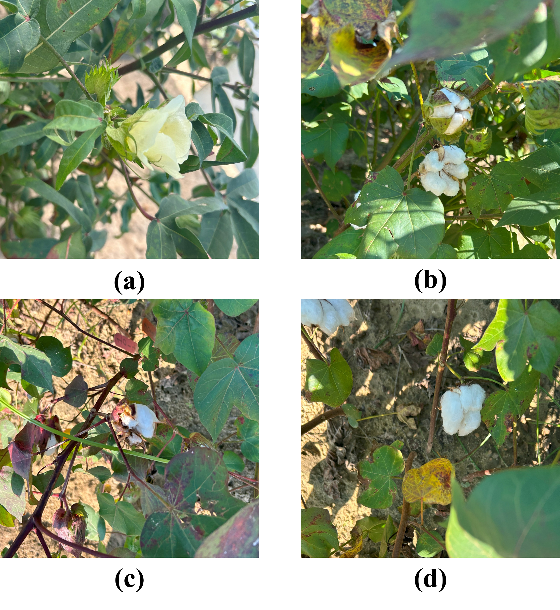

# Cott-ADNet
This repository is for the paper: [Cott-ADNet: Lightweight Real-Time Cotton Boll and Flower Detection Under Field Conditions](https://openaccess.thecvf.com/content/WACV2026W/HARVEST-Vision/html/Wang_Cott-ADNet_Lightweight_Real-Time_Cotton_Boll_and_Flower_Detection_Under_Field_WACVW_2026_paper.html), including the pretrain model and dataset for reproducing.

The paper is accepted by Accepted to **HARVEST-Vision 2026** (Second International Workshop on Applications of CV and HPC in Agriculture), in conjunction with [**IEEE/CVF WACV 2026**](https://wacv.thecvf.com/Conferences/2026).

## Overview of the Cott-ADNet
<p align="center">
  
  <br>
  <em>Overview of Cott-ADNet framework and its key modules.</em>
</p>

## Samples of External Test Set
<p align="center">
  
  <br>
  <em>Data Samples of independent External Test Set.</em>
</p>

## Performance
<p align="center">
  
  <br>
  <em>Detection results of Cott-ADNet on the Internal Test Set and External Test Set.</em>
</p>

## Dataset
The External Test Set has been released on [Kaggle--Cotton Boll and Flowers Recognition Dataset](https://www.kaggle.com/datasets/sweefongwong/cotton-boll-and-flowers-recognition-dataset).


## Citation

If you find this work useful, please cite:

```bibtex
@inproceedings{wang2026cott,
  title={Cott-ADNet: Lightweight Real-Time Cotton Boll and Flower Detection Under Field Conditions},
  author={Wang, Rui-Feng and Xu, Mingrui and Bauer, Matthew and Schardong, Iago and Ma, Xiaowen and Chee, Peng and Cui, Kangning},
  booktitle={Proceedings of the IEEE/CVF Winter Conference on Applications of Computer Vision},
  pages={500--509},
  year={2026}
}
